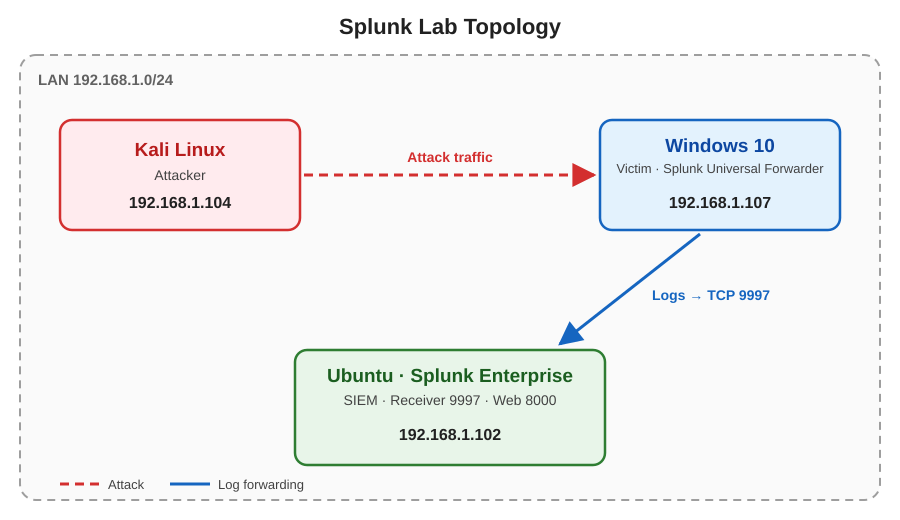

# SOC-HOME-LAB
*A home lab simulating SMB brute-force and password spraying attacks, detected and analyzed using Splunk SIEM.*

## Overview
This project is a hands-on home lab built to simulate, detect, and analyze SMB-based credential attacks — specifically Brute Force and Password Spraying — using Splunk Enterprise as the SIEM platform.

The goal was to build a small, self-contained environment that mirrors how attacks and detection work in a real SOC: an attacker machine, a vulnerable target, and a centralized logging system, all communicating over a local network.

Beyond the technical setup, this project was a practical step in my self-study path toward a SOC Analyst role — giving me hands-on experience deploying a SIEM, analyzing real authentication logs, and troubleshooting issues like an actual analyst would.

## Lab Architecture
Three VMs on an isolated local network, simulating SMB brute-force and password spraying attacks against a Windows host, detected via Splunk.
- Attacker: Kali Linux 2026.2 — NetExec (nxc) for brute-force & password spraying
- Victim: Windows 10 — Sysmon 15.21 + Splunk Universal Forwarder
- SIEM: Ubuntu 24.04.5 LTS — Splunk Enterprise 10.6.0.5

## Lab Setup
- Installed Splunk Enterprise on Ubuntu, enabled receiving on port 9997.

- Installed Splunk Universal Forwarder on Windows 10, pointed to 192.168.1.102:9997.

- Configured inputs.conf on the Forwarder to collect Security, System, and Sysmon logs into index=windows_logs.

- Verified log flow in Splunk: index="windows_logs" EventCode=4625.

## Attack Simulation

Simulated SMB brute-force and password spraying attacks from Kali Linux against the Windows 10 host using NetExec (nxc), with wordlists placed on the Desktop.

- Performed brute-force attack (single user, multiple passwords — LABPASS.TXT) using NetExec.
nxc smb 192.168.1.107 -u testuser -p LABPASS.TXT

## Detection (Splunk Queries)

Analyzed the forwarded Windows logs in Splunk to detect and investigate the brute-force and password spraying activity.

- Timeline of failed and successful authentication attempts over time.

index="windows_logs" (EventCode=4625 OR EventCode=4624) | timechart count span=1m

- Comparison of failed vs. successful login attempts per account and source IP.

index="windows_logs" (EventCode=4625 OR EventCode=4624) | stats count(eval(EventCode=4625)) as failures, count(eval(EventCode=4624)) as success by Account_Name, Source_Network_Address

- Number of unique accounts targeted per source IP, confirming password spraying behavior.

index="windows_logs" EventCode=4625 | stats dc(Account_Name) as unique_user count by Source_Network_Address

- Performed password spraying attack (multiple users, single password — LABUSER.TXT) using NetExec.
nxc smb 192.168.1.107 -u LABUSER.TXT -p 'labpassword'

Both wordlists contained the correct credential within the list, resulting in a successful authentication (Event ID 4624) preceded by multiple failed attempts (Event ID 4625) — simulating a realistic brute-force/spray pattern for detection in Splunk.

## Findings
- All failed logins (EventCode 4625) came from a single source IP (192.168.1.104), targeting multiple accounts — a password spraying pattern.
- A successful login (EventCode 4624) followed, confirming the attack succeeded.

## Recommendations
- Enforce strong passwords and account lockout policies.
- Restrict SMB exposure via firewall rules; disable SMBv1 where possible.
- Monitor failed logons and build SIEM detection rules for brute-force/spray patterns.

## Conclusion
A simulated SMB brute-force/password spraying attack was detected and analyzed using Splunk, demonstrating hands-on log forwarding and detection skills in an isolated lab environment.

